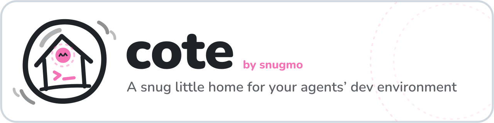

# Cote

<picture>
  <source media="(prefers-color-scheme: dark)" srcset="assets/cote-banner-dark.svg">
  
</picture>

> A snug little home for your agents' dev environment.

`cote` is the base image for the [Snugmo](https://github.com/snugmo) agent development environment.
It provides the shell, tools, and context your agents need to work.

[](https://ghcr.io/snugmo/cote)

## What's inside

- A curated, opinionated set of CLI tools and language runtimes
- Pre-wired context and conventions so agents start productive immediately
- A single, stable image tag your whole team can trust

## Toolchain

| Language / Tool                                                    | Version         | Source                                                    |
| ------------------------------------------------------------------ | --------------- | --------------------------------------------------------- |
| **[Go](https://go.dev)**                                           | 1.27.3          | go.dev/dl                                                 |
| **[Node.js](https://nodejs.org)**                                  | 26              | [fnm](https://github.com/Schniz/fnm)                      |
| **[Bun](https://bun.sh)**                                          | latest          | [oven-sh/bun](https://github.com/oven-sh/bun) (OCI image) |
| **[Python](https://python.org)**                                   | Fedora 45 stock | dnf                                                       |
| **[Rust](https://rust-lang.org)**                                  | stable          | [rustup](https://github.com/rust-lang/rustup)             |
| **[cargo-binstall](https://github.com/cargo-bins/cargo-binstall)** | latest          | crates.io (`cargo install`)                               |
| **[Java](https://adoptium.net/temurin/releases)**                  | 25              | dnf (Adoptium Temurin repo)                               |
| **[Maven](https://maven.apache.org)**                              | Fedora 45 stock | dnf                                                       |
| **[GCC](https://gcc.gnu.org) / [Clang](https://clang.llvm.org)**   | Fedora 45 stock | dnf                                                       |
| **[Crush CLI](https://github.com/charmbracelet/crush)**            | 0.100.0         | GitHub release, cosign verified                           |
| **[uv](https://github.com/astral-sh/uv)**                          | 0.13.7          | GitHub release                                            |
| **[cosign](https://github.com/sigstore/cosign)**                   | 3.1.4           | OCI image                                                 |
| **[SimpleX Chat CLI](https://simplex.chat/docs/cli.html)**         | 7.0.3           | GitHub release (SHA-256 in release notes)                 |
| **[nono](https://github.com/nolabs-ai/nono)**                      | 0.81.0          | GitHub release (SHA-256SUMS.txt)                          |
| **[Lola](https://docs.getlola.dev)**                               | latest          | PyPI (`lola-ai`)                                          |

**LSP servers**:

| Server                                                                                                 | Languages                | File extensions                                        |
| ------------------------------------------------------------------------------------------------------ | ------------------------ | ------------------------------------------------------ |
| [gopls](https://github.com/golang/tools/tree/master/gopls)                                             | Go                       | `.go`                                                  |
| [golangci-lint-langserver](https://github.com/nametake/golangci-lint-langserver)                        | Go                       | `.go`                                                  |
| [typescript-language-server](https://github.com/typescript-language-server/typescript-language-server) | TypeScript, JavaScript   | `.ts`, `.tsx`, `.js`, `.jsx`                           |
| [pyright](https://github.com/microsoft/pyright)                                                        | Python                   | `.py`                                                  |
| [pyrefly](https://github.com/facebook/pyrefly)                                                         | Python                   | `.py`                                                  |
| [ruff server](https://github.com/astral-sh/ruff)                                                       | Python                   | `.py`                                                  |
| [yaml-language-server](https://github.com/redhat-developer/yaml-language-server)                       | YAML                     | `.yaml`, `.yml`                                        |
| [marksman](https://github.com/artempyanykh/marksman)                                                   | Markdown                 | `.md`                                                  |
| [helm-ls](https://github.com/mrjosh/helm-ls)                                                           | Helm                     | `.yaml`, `.yml`                                        |
| [tofu-ls](https://github.com/opentofu/tofu-ls)                                                         | OpenTofu, HCL, Terraform | `.tf`, `.tfvars`, `.hcl`, `.tofu`                      |
| [protols](https://github.com/kralicky/protols)                                                         | Protocol Buffers         | `.proto`                                               |
| [bash-language-server](https://github.com/bash-lsp/bash-language-server)                               | Bash, Shell              | `.sh`, `.bash`, `.zsh`, `.fish`                        |
| [dockerfile-language-server](https://github.com/rcjsuen/dockerfile-language-server)                    | Dockerfile               | `Dockerfile`, `Containerfile`, `.dockerfile`           |
| [clangd](https://github.com/clangd/clangd)                                                             | C, C++, Objective-C      | `.c`, `.h`, `.cpp`, `.cc`, `.cxx`, `.hpp`, `.m`, `.mm` |
| [rust-analyzer](https://github.com/rust-lang/rust-analyzer)                                            | Rust                     | `.rs`, `Cargo.toml`                                    |

**Linters & formatters**:

| Tool                                                       | Languages                                         | File extensions                               |
| ---------------------------------------------------------- | ------------------------------------------------- | --------------------------------------------- |
| [shellcheck](https://github.com/koalaman/shellcheck)       | Bash, Shell                                       | `.sh`, `.bash`, `.zsh`, `.fish`               |
| [shfmt](https://github.com/mvdan/sh)                       | Shell (formatter)                                 | `.sh`, `.bash`, `.zsh`                        |
| [hadolint](https://github.com/hadolint/hadolint)           | Dockerfile                                        | `Dockerfile`, `Containerfile`, `.dockerfile`  |
| [golangci-lint](https://github.com/golangci/golangci-lint) | Go                                                | `.go`                                         |
| [eslint](https://github.com/eslint/eslint)                 | JavaScript, TypeScript                            | `.js`, `.jsx`, `.ts`, `.tsx`                  |
| [prettier](https://github.com/prettier/prettier)           | JavaScript, TypeScript, JSON, YAML, Markdown, CSS | `.js`, `.ts`, `.json`, `.yaml`, `.md`, `.css` |
| [pylint](https://github.com/pylint-dev/pylint)             | Python                                            | `.py`                                         |
| [ruff](https://github.com/astral-sh/ruff)                  | Python                                            | `.py`                                         |
| [mypy](https://github.com/python/mypy)                     | Python (type checker)                             | `.py`                                         |
| [pyrefly](https://github.com/facebook/pyrefly)             | Python (type checker)                             | `.py`                                         |
| [black](https://github.com/psf/black)                      | Python (formatter)                                | `.py`                                         |

**Kubernetes / cloud tools**: `kubectl`, `helm`, `kustomize`, `opentofu`, `awscli2`, `kubeseal` (0.41.2), `kubectl-cnpg` (1.30.1), `kubectl-linstor` (0.3.2), `cmctl` (2.6.2), `agctl` (1.7.0), `mcp-cli` (0.3.0), `fj` (0.7.0), `gh` (2.103.3), `kubeconform` (0.8.0).

**Shell utilities**: `git`, `ripgrep`, `fd-find`, `jq`, `yq`, `bat`, `glow`, `tmux`, `herdr` (0.9.5), `age`, `gnupg2`, `ImageMagick`, `librsvg2-tools`, `libsixel-utils`, `potrace`, `exif`, `exiv2`.

## Extensions

Optional add-on images built on the base:

- **[Hermes agent](extensions/hermes/)** — AI coding agent with ACP support for IDE integration (VS Code, Zed, JetBrains).
- **[Pi agent](extensions/pi/)** — Terminal coding agent (official `@earendil-works/pi-coding-agent` npm package) with interactive, print, RPC, and SDK modes.
- **[PiG (Pi in Go) agent](extensions/pi-in-go/)** — Terminal coding agent in Go (official `@pi-in-go/pig` npm package), a faithful port of Pi as a single native binary, with interactive, print, RPC, and Go SDK modes.
- **[Xpra remote X11 desktop](extensions/xpra/)** — Xpra server + X11 (headless Xdummy/Xvfb, openbox, xterm) and the xpra-html5 browser client; serve a headless desktop from any browser or a native xpra client via the `xpra-desktop` launcher.

## Usage

Build the base image and run it either in Kubernetes via DevWorkspaces Operator or standalone with podman:

### DevWorkspaces Operator

The recommended way to run these images in Kubernetes:

```bash
# Build and push the base image
./base-image/build.sh push

# Apply a workspace
kubectl apply -f devfiles/devfile.yaml
```

See [AGENTS.md](AGENTS.md) for Devfile conventions and gotchas.

### Standalone

Run directly with podman — mount your code, preserve caches, and enable rootless containers via FUSE:

```bash
podman run -d --replace --name=cote \
  --security-opt=label=disable \
  --userns=keep-id:uid=1000,gid=1000 \
  -v ~/workspace:/projects/ -w /projects \
  --device=/dev/fuse \
  -v dev-home:/home/user \
  ghcr.io/snugmo/cote:latest-base
```

With no command the container runs `catatonit -P` — a pause container that just stays alive — so `exec` into it to start a shell inside the container namespace:

```bash
podman exec -ti -e TERM -e COLORTERM cote "${SHELL}"
```

## Design

- Base image provides compilers, package managers, shell utils, and LSP servers — no IDEs baked in, keeping the base lean and portable.
- IDEs and AI agents are added as separate Devfile components or extension images, chosen per-team or per-project.
- Extensions keep the base lean while enabling agent-ready workspaces when needed.
- Workspace containers run as non-root (UID 1000).
- All binary downloads are verified as far as possible: where upstreams publish SHA-256s, the download itself is an `ADD --checksum=sha256:…` in the Containerfile; otherwise cosign signatures or SLSA provenance — not all upstreams provide cryptographic signatures.

## Details

See [AGENTS.md](AGENTS.md) for conventions, commands, and gotchas.
